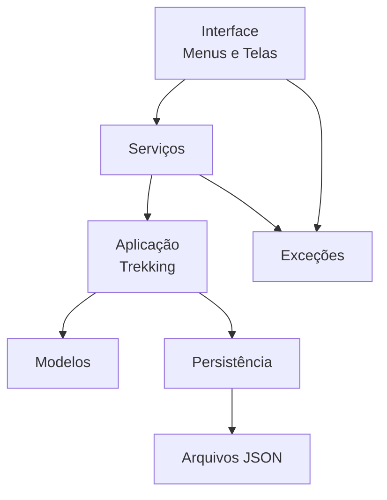

# Arquitetura — Terceira Versão

O projeto de trekking foi refatorado para separar a interface, os serviços,
a aplicação e os modelos. Os dados são mantidos em listas privadas durante a execução e persistidos em arquivos JSON.



## Responsabilidades

- **Interface:** lê entradas do usuário, chama serviços e apresenta resultados.
- **Serviços:** concentram operações e regras de negócio.
- **Aplicação:** mantém coleções privadas, carrega objetos ao iniciar e coordena a gravação após alterações.
- **Modelos:** representam Corrida, Equipe, Professor, Checkpoint e Passagem.
- **Exceções:** representam situações inválidas previstas pelas regras do domínio.

## Serviços

```text
servicos/
├── corrida_service.py
├── equipe_service.py
├── professor_service.py
├── checkpoint_service.py
├── passagem_service.py
└── dependencias.py
```

A interface não chama mais métodos de negócio diretamente em `Trekking`.
Por exemplo, o registro de uma passagem percorre:

```text
TelaPassagens
      ↓
PassagemService
      ↓
Trekking (dados em memória)
      ↓
Modelos
```

Uma regra inválida também segue a mesma arquitetura:

```text
TelaPassagens
      ↓
PassagemService.registrar()
      ↓
PassagemJaRegistradaError / EquipeNaoParticipanteError / ...
      ↓
Tela captura a exceção e exibe a mensagem
```


## Persistência e reconstrução

`persistencia/json_persistencia.py` converte objetos de domínio em dados simples e vice-versa. As relações são salvas por identificadores e reconstituídas após carregar corridas, equipes e professores. Checkpoints são reconstruídos depois de seus responsáveis; passagens, por último. Os serviços não leem nem gravam arquivos diretamente.

A aplicação grava automaticamente os cadastros e solicita nova gravação depois das operações que atualizam relacionamentos. JSON malformado ou IDs inexistentes produzem `ErroPersistencia`, impedindo a inicialização com dados inconsistentes. Os arquivos inexistentes são inicializados com `[]`.

Fluxo testado: cadastrar corrida, equipe, professor, checkpoint, participação e passagem → encerrar aplicação → criar nova aplicação → confirmar que todos os objetos e vínculos foram restaurados.
