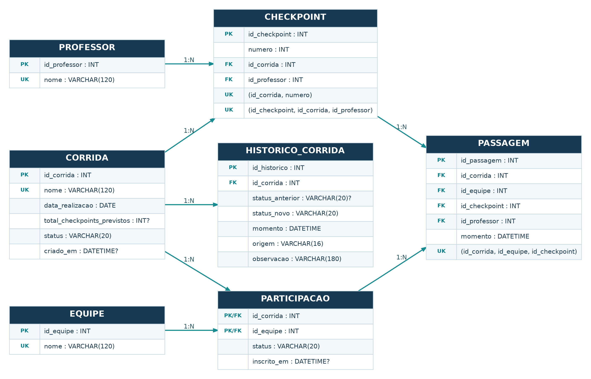
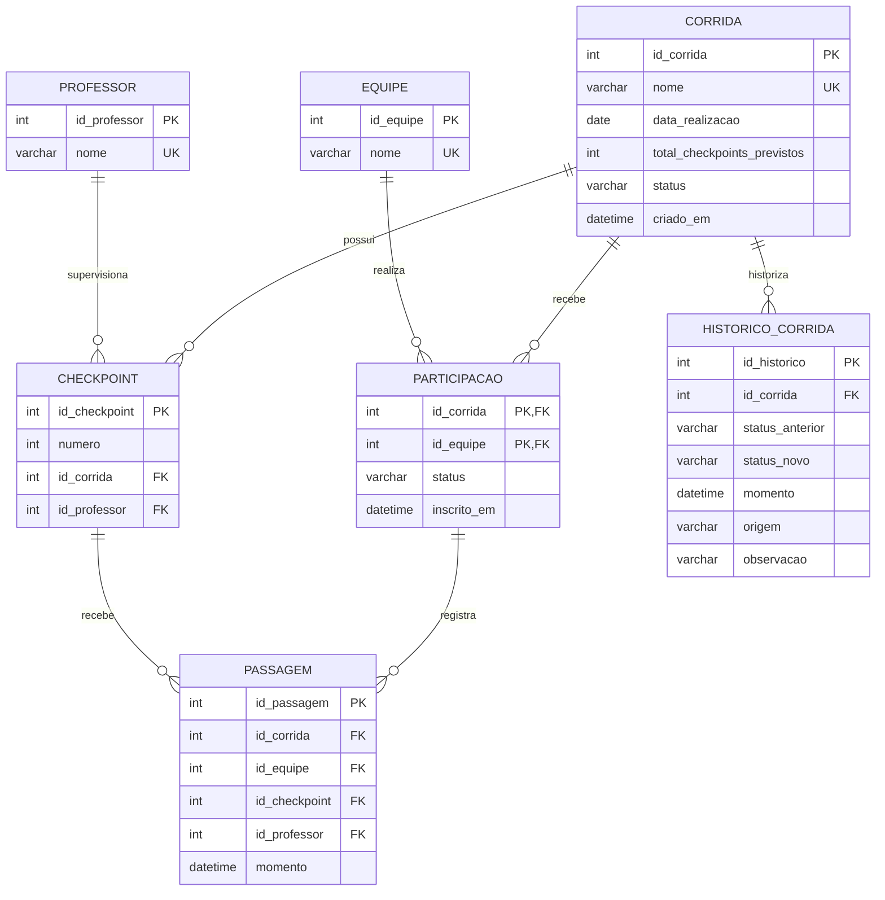

# CheckpointsTrekking — Projeto de Dados Final

**Estudo de caso:** Sistema de Gerenciamento e Acompanhamento de Corridas de Trekking  
**Turma:** Infoweb 2V  
**Integrantes:** Pedro Júlio, Francisco Thalys e Luiz Guilherme Pereira  
**Branch de entrega:** `projeto-dados-final`

## 1. Visão geral

O CheckpointsTrekking organiza corridas de trekking, equipes, professores responsáveis pelos postos de controle e registros de passagem das equipes pelos checkpoints. Cada corrida possui checkpoints numerados, e cada equipe precisa participar oficialmente da etapa antes que sua passagem possa ser registrada. O professor de cada checkpoint deve corresponder ao responsável cadastrado.

A aplicação foi desenvolvida em Python com divisão entre **modelos**, **serviços**, **interface**, **aplicação**, **exceções** e **persistência JSON**. A quarta versão adicionou o cadastro de `total_checkpoints_previstos` e sua persistência em JSON. O banco relacional apresentado nesta etapa é a base prevista para a futura integração com POO, sem afirmar que o programa Python já utiliza MySQL.

## 2. Banco de dados e evolução

- **SGBD:** MySQL **8.0.16 ou superior** (uso de `CHECK`).
- **Nome do banco:** `checkpoints_trekking`.
- **Quantidade de tabelas:** **7** (seis anteriores e `historico_corrida`).
- **Base anterior preservada:** 1.000 registros, com seus identificadores e comandos de inserção.
- **Base final:** **4.013 registros** fictícios.

### Alterações justificadas

| Entidade | Decisão | Necessidade atendida |
| --- | --- | --- |
| `corrida` | `data_realizacao`, `status`, `criado_em` e `total_checkpoints_previstos` | Agenda, situação atual e total de pontos planejados, alinhados à quarta versão em Python. |
| `participacao` | `status` e `inscrito_em` | Diferenciar inscrição, conclusão, desistência e cancelamento por equipe. |
| `historico_corrida` | Nova entidade com transição de status, momento, origem e observação | Preservar eventos anteriores sem apagar o estado atual da corrida. |
| `passagem` | Estrutura temporal e FKs compostas mantidas | Registrar quando a equipe chegou ao posto, com controle de duplicidade e de responsável. |
| `checkpoint`, `equipe`, `professor` | Estruturas principais mantidas | Os campos e relacionamentos existentes atendem às regras do estudo de caso. |

**Dados legados:** `corrida.data_realizacao` foi inferida da primeira passagem de cada corrida antiga. Como a base anterior não registrava os horários de criação e inscrição nem o número originalmente previsto de checkpoints, esses campos permanecem `NULL` nos registros legados correspondentes, em vez de receber dados históricos inventados. As 40 entradas legadas de `historico_corrida` representam um **estado importado**, não transições de usuários. Os novos registros possuem situações e datas variadas e transições simuladas coerentes.

## 3. Modelo entidade-relacionamento





**Chaves e cardinalidades:** `corrida` e `equipe` formam relação N:M por `participacao` (PK composta). Cada `checkpoint` pertence a uma única `corrida` e possui um `professor`. Cada `passagem` referencia uma participação válida, e a FK composta para `checkpoint` obriga coincidência entre a corrida e o professor responsável. A restrição `UNIQUE(id_corrida, id_equipe, id_checkpoint)` impede registros duplicados no mesmo posto. Uma `corrida` pode ter vários eventos de histórico.

## 4. Massa de dados fictícios

| Tabela | Registros finais |
| --- | ---: |
| `corrida` | 85 |
| `equipe` | 330 |
| `professor` | 48 |
| `checkpoint` | 410 |
| `participacao` | 1.060 |
| `passagem` | 1.930 |
| `historico_corrida` | 150 |
| **Total** | **4.013** |

Os dados originais (40 corridas, 180 equipes, 30 professores, 150 checkpoints, 300 participações e 300 passagens) foram mantidos. Foram acrescentados **3.013 registros** em categorias, datas e períodos plausíveis. A geração de dados contou com auxílio de IA e roteiro determinístico; a verificação automatizada conferiu quantidade de registros, FKs, unicidade, relações de passagens, coerência temporal e transições de histórico em ambiente de testes. O script fornecido é autocontido: não depende dos arquivos auxiliares usados na geração.

## 5. Relatórios SQL

O arquivo [**relatorios.pdf**](relatorios.pdf) apresenta a finalidade, os atributos, os resultados esperados, a utilidade e a consulta SQL completa para:

1. **Panorama mensal das corridas:** etapas por mês e situação (`COUNT`, `CASE`, `SUM`, `GROUP BY`).
2. **Progresso das equipes por corrida:** checkpoints atravessados em relação aos cadastrados (`JOIN`, `COUNT DISTINCT`, `HAVING`).
3. **Checkpoints de maior movimento:** equipes atendidas e horários de maior movimentação (`JOIN`, `MIN`, `MAX`, `ORDER BY`).
4. **Auditoria das mudanças de situação:** evolução dos estados das corridas (`JOIN`, `WHERE`, `ORDER BY`).

As consultas são compatíveis com MySQL 8.0.16+ e têm exemplos de saída derivados da massa de dados.

## 6. Planejamento da versão final em POO

**Classes de domínio:** `Corrida`, `Equipe`, `Professor`, `Checkpoint`, `Passagem`, além de `Participacao` e `HistoricoCorrida` a serem incorporadas à modelagem de objetos. Os serviços devem preservar regras de negócio e encapsular o acesso aos dados por meio de repositórios/DAOs MySQL.

**Funcionalidades prioritárias:** cadastros e consultas de corridas, equipes, professores e checkpoints; definição do total previsto de postos; inscrição de equipes; validação de responsável e de participação antes de registrar passagem; consulta por filtros; atualização de estados; registro e consulta do histórico; quatro relatórios SQL.

**Regras principais:** nomes únicos por tipo; número de checkpoint único em cada corrida; professor responsável obrigatório; participação na corrida antes da passagem; apenas uma passagem por equipe em cada checkpoint; restrições a exclusões de registros vinculados; datas coerentes e situações válidas. Alterações de status devem gerar eventos, preferencialmente dentro da mesma transação.

**Implementação por etapas:** (1) persistência e cadastros, (2) inscrições e passagens, (3) históricos e relatórios, (4) interface integrada e testes. Funcionalidades futuras podem incluir autenticação por perfis, GPS, notificações e integração externa, fora do escopo obrigatório da versão acadêmica.

### Estrutura da aplicação Python existente

```text
main.py / aplicacao.py / trekking.py
modelos/            objetos de domínio
servicos/           regras de negócio
interface/          menus e telas
excecoes/           erros de domínio
persistencia/       persistência em JSON na quarta versão
dados/              arquivos JSON da aplicação
testes/             testes automatizados
ARQUITETURA.md      documentação de arquitetura
```

A aplicação continua executável por `python main.py`. Os testes da quarta versão podem ser executados com `python -m unittest discover -s testes -v`.

## 7. Como recriar o banco

1. Utilize **MySQL 8.0.16+** em um **ambiente de testes** com permissão de criar o banco `checkpoints_trekking`.
2. Abra `database.sql` no MySQL Workbench e execute o arquivo integralmente. Alternativamente, no terminal: `mysql -u USUARIO -p < database.sql`.
3. O script cria o banco (se necessário), remove as sete tabelas desse banco e as recria, preservando no conjunto de inserções os 1.000 dados anteriores, seguidos da expansão.
4. Execute as consultas de contagem ao final do arquivo: o total esperado é **4.013** registros.
5. Consulte as quatro consultas analíticas no [relatório em PDF](relatorios.pdf).

**Atenção:** reexecutar o script recria as tabelas e descarta eventuais mudanças feitas posteriormente nelas. Não execute sobre uma base de produção sem cópia de segurança.

## 8. Arquivos desta entrega

- [`database.sql`](database.sql) — DDL, restrições, dados anteriores e ampliação até 4.013 registros.
- [`relatorios.pdf`](relatorios.pdf) — análise da evolução, DER, massa de dados, consultas e planejamento POO.
- [`der_atualizado.png`](der_atualizado.png) — imagem completa do diagrama ER.
- `README.md` — documentação do estudo de caso e instruções de execução.

## 9. Versionamento

A entrega está organizada para a branch `projeto-dados-final`, no mesmo repositório utilizado nas etapas anteriores, preservando os arquivos, branches e commits já existentes. A base relacional anterior está na branch `banco-de-dados` e a quarta versão da aplicação Python está em `quarta-versao`.
