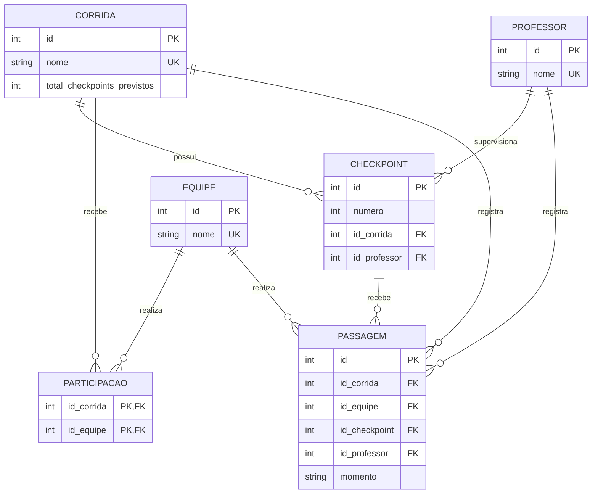

# CheckpointsTrekking — quarta versão (SQLAlchemy ORM)

**Turma:** Infoweb 2V  
**Integrantes:** Pedro Júlio, Francisco Thalys e Luiz Guilherme Pereira.

## Estudo de caso
Gerenciamento de corridas de trekking, equipes, professores, checkpoints, inscrições e passagens. A versão preserva os menus e as validações anteriores, incluindo o total de checkpoints previstos. A persistência em JSON foi substituída por SQLite e SQLAlchemy ORM. Os arquivos JSON da versão recebida estavam vazios; não foi necessária migração.

## Instalação e execução
Requer Python 3.10 ou superior. No terminal, na raiz do projeto:

```bash
python -m pip install -r requirements.txt
python main.py
```

O banco local `dados/trekking.db` é criado automaticamente se não existir. Não exige XAMPP nem servidor MySQL. O arquivo entregue contém registros fictícios de um fluxo de teste. Para testar em uma base vazia, faça backup do arquivo e remova-o antes de iniciar.

## Arquitetura e persistência
- `modelos/`: entidades ORM, `DeclarativeBase`, `Mapped`, `mapped_column`, chaves e relacionamentos bidirecionais. A tabela associativa `participacao` representa o N:N.
- `persistencia/banco.py`: engine SQLite, ativação de chaves estrangeiras, `Base.metadata.create_all()` e fábrica de sessões.
- `persistencia/sessao.py`: confirmação e rollback das transações.
- `aplicacao.py`: centraliza a sessão da execução, `add`, `select`, `scalars`, `delete`, `commit` e encerramento. A sessão permanece aberta durante os menus para permitir navegação pelas relações ORM; é fechada ao sair.
- `servicos/`: operações e validações; `interface/`: menus e entrada/saída, sem consultas diretas ao banco.
- `testes/`: testes automatizados com bancos temporários, sem modificar o arquivo entregue.

## Diagrama do banco SQLite


A unicidade de checkpoint é definida pelo par corrida/número. A unicidade de passagem é definida pela combinação corrida/equipe/checkpoint. Os serviços validam a inscrição e a correspondência de corrida e professor antes de registrar a passagem. Os nomes são consultados sem distinção de maiúsculas/minúsculas. O momento permanece textual, como na versão anterior. O banco SQLite desta atividade não é o banco MySQL da disciplina de Banco de Dados.

## Operações e testes
Os menus anteriores foram mantidos. As opções 8 e 9 nos menus de corridas, equipes e professores permitem atualizar nomes e remover registros sem dependências; registros vinculados são protegidos pelas validações dos serviços. Os registros de passagem são preservados como histórico operacional.

```bash
python -m unittest discover -s testes -v
```

Os testes verificam cadastro, consulta, relacionamentos, reinício, atualização, remoção, integridade referencial, duplicidade, participação e responsabilidade pelo checkpoint, além das validações e consultas da versão anterior. Para demonstrar a persistência, cadastre uma equipe, saia pelo menu e execute novamente `python main.py`.
